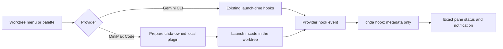

# Gemini and MiniMax support

Version: 1.0. Status: proposed; implementation approval pending.
Baseline: `fc8512afb550348156db8271d7b46d6a0e0c31b6`.
Test plan: [test-plan.json](test-plan.json).

## Current behavior and purpose

Gemini CLI already has an adapter, launch-time hooks, transcript indexing,
exact conversation resume and a GPUI status scenario. Copilot CLI and OpenCode
also have adapters. The default `agents` list contains only Claude and Codex,
so the other providers need an explicit configuration entry to appear.
MiniMax Code has no adapter.

Expose Gemini and add an initial MiniMax Code integration through the existing
menus and Sessions rows. Keep the present layout and status vocabulary.

## Proposed scope

| Capability | Gemini CLI | MiniMax Code |
| --- | --- | --- |
| Default menu and palette entries | Add to default list | Add to default list |
| Worktree launch, presets and default action | Retain and verify | Add `minimax`, executing `mcode` |
| Working, waiting, completed and ended status per pane | Retain and verify | Add native hook mapping |
| Notifications and jump to waiting pane | Retain and verify | Use existing behavior |
| Past conversations and exact resume | Retain and verify | Defer; explain unavailable resume |
| Token pricing, quota and child activity | Preserve current coverage | Defer |

The default list becomes `["claude", "codex", "gemini", "minimax"]`.
An explicit user `agents` list retains its contents and order; do not rewrite
the user's configuration. A missing executable uses the existing launch error.
Users who already have an explicit list can add the two IDs themselves.

Example configuration:

```toml
agents = ["claude", "codex", "gemini", "minimax"]

[[agent-presets]]
name = "MiniMax Code"
agent = "minimax"
args = []
```

## User flow



## MiniMax integration boundary

Research baseline: installed Gemini CLI `0.59.0` and MiniMax Code `0.6.12`;
MiniMax upstream source `5821f7c9b0363a9b97a57fff3deaa4cd2da165a4`.
The observed `mcode --help` has no launch-time plugin/settings injection flag.
Do not assume Claude-compatible flags are accepted.

Use MiniMax's supported local plugin discovery. Generate a narrowly scoped
`chda-status` package and install it only when launching MiniMax through chda,
under the resolved MiniMax data directory's `plugins/chda-status` directory.
Do not install anything into MiniMax at chda startup. Honor the CLI's data
directory and profile selection; do not migrate legacy directories or change
its selected profile. Validate resolution against the installed CLI in an
isolated home before treating a profile as supported.

The plugin contains a manifest, hook registration and a small Node helper.
Register `SessionStart`, `UserPromptSubmit`, `PermissionRequest`, `Stop` and
`SessionEnd`; use a verified post-permission event to clear a waiting state
when work continues. Map only observed native payload fields. Ignore child
session events until exact parent relationships are supported. Cancellation or
failure without a normal `Stop` must not be reported as successful completion.

The helper runs only with the chda pane and helper environment present. Outside
a managed launch it is a no-op, so the persistent plugin does not collect
unrelated MiniMax activity. Pass only provider ID, session ID, working directory,
event kind, timestamp and pane ID into the existing IPC receiver. Do not retain
prompts, tool arguments, answers or credentials.

This is a deliberate exception to the adapters' present chda-data-only hook
installation rule. Propose the exception in an ADR before changing that rule.
Keep adapter registration, executable lookup and hook parsing in `chda-agents`;
keep provider choices in `chda-config` and existing display handling in
`chda-ui`. Add no direct GPUI dependency to other crates.

Never overwrite another package with the same name. Update only files whose
previous contents are verified as chda-owned, atomically, with recoverable
previous contents. Preserve a user-disabled plugin and all other plugins.
Report collisions, permission failures and unsupported CLI versions through
the existing error path. If discovery requires changing user config, plugin
enablement records, credentials or session databases, stop and revise this
design instead of adding those mutations silently.

MiniMax historical sessions, automatic conversation restore, exact restart,
transcript sharing, account reports and usage remain unavailable in this first
increment. Return the existing unsupported-resume explanation rather than
opening a fresh or latest conversation. Do not guess session storage formats.
Plain `mcode` typed into a shell does not acquire managed hooks in this scope.

## Acceptance and delivery

The test plan covers real shell launch arguments and isolated plugin discovery,
hook forwarding and pane identity, the existing status and notification journey,
failure handling, preservation of explicit configuration and other providers,
and truthful unsupported-resume behavior. Use synthetic data and temporary
homes. Live authenticated model turns are outside this plan and must be
reported as unrun.

Update `docs/product-features.json`, generate README and Pages sections, update
setup instructions and `docs/testing.md`, and inspect any changed rendered
examples at desktop and narrow widths. Do not edit version or changelog files.
The implementation endpoint is a reviewed Ready PR with the required checks;
publishing a release is outside this request.

The alternative is to include MiniMax historical conversation indexing and
exact resume now. That requires a separate storage-format investigation and
more restore and corruption scenarios; it is not included in version 1.0.

## Research and baseline verification

- `cargo test -p chda-agents gemini`: 3 passed on the unchanged baseline.
- [Gemini hook reference](https://geminicli.com/docs/hooks/reference/).
- [MiniMax CLI and data directories](https://github.com/MiniMax-AI/minimax-code/blob/5821f7c9b0363a9b97a57fff3deaa4cd2da165a4/README.md).
- [MiniMax local plugin management](https://github.com/MiniMax-AI/minimax-code/blob/5821f7c9b0363a9b97a57fff3deaa4cd2da165a4/docs/examples.md#4-manage-plugins).
- [MiniMax hook behavior and event limits](https://github.com/MiniMax-AI/minimax-code/blob/5821f7c9b0363a9b97a57fff3deaa4cd2da165a4/docs/hooks.md).
- [MiniMax plugin discovery implementation](https://github.com/MiniMax-AI/minimax-code/blob/5821f7c9b0363a9b97a57fff3deaa4cd2da165a4/packages/local-runtime-v2/src/service/plugin-system/plugin/runtime/package-storage.ts).
