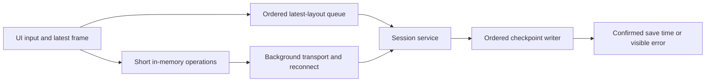

# Session connection recovery and responsiveness

Status: withdrawn on 2026-10-24 and superseded by the [rollback](../2026-10-24-session-service-rollback/design.md). The owner originally approved this repair on 2026-10-23 with “어서 고쳐”. The historical implementation retained the service ownership decision in [ADR 0024](../../decisions/0024-dedicated-session-service.md).

## Observed problem

The reported window showed `Session service connection lost: Broken pipe
(os error 32)` and stopped accepting input after being left open. The owner also
reported persistent stuttering. Repository baseline:
`cb4eec84a66bd19545000ca1fa0023e161e84618`.

An isolated reproduction with the installed 1.5.0 helper, protocol 1, confirmed
that a connection left without requests for 12 seconds fails with exactly
`BrokenPipeError: [Errno 32] Broken pipe`. A separate connection confirmed that
the server instance and shell PID were unchanged, the shell was still marked
running, and a fresh connection could send input. The helper SHA-256 was
`7ce3cec05da7d40f4160ff50f11aa7f2447fbd7383358e5cd8b944a149c2325e`.
This reproduces a communication pause, not an ordinary idle GUI, which normally
continues polling. It does not prove that the original incident included sleep
or that its processes survived.

The owner's installed-1.5.0 hang report from 2026-10-23 21:53:24 +09:00
subsequently confirmed the main thread in `refresh_repos`, `sync_panes`,
`save_session`, then the client mutex/socket wait throughout its eleven samples.
The same report included the still-present service waiting for terminal capture
inside `Runtime::flush` or its runtime mutex. A separate macOS disk-writes report
recorded 2151.22 MB of file-backed memory dirtied over 486 seconds, with checkpoint
writes in its sampled stacks and `Action taken: none`. These are observations of
the old installed version, not candidate validation, retained-file sizes or proof
that the service crashed. Raw system reports remain private and user-owned.

Read-only, three-second samples of the currently running 1.5.0 app and service
found the UI main thread waiting in both `WorkspaceView::save_session`'s socket
read and `Session::frame`'s mutex lock. The service sample also contained
checkpoint writes and filesystem synchronization. This establishes blocking
paths; it does not attribute every visible stutter to one cause.

| Code path | Problem |
| --- | --- |
| `server::connection` | Its ten-second read timeout closes a quiet, established connection. |
| `Client::request`, remote view loop and hook watch | Broken connections remain unusable; terminal and hook polling stop after an error. |
| Remote view's `Request::Poll` expression | The frame mutex guard used to collect image identities lives through the network request. A UI frame read can wait for the service response. |
| `WorkspaceView::save_session` | The UI synchronously waits for checkpoint completion. |
| `Runtime::flush` and request dispatch | Text capture and durable disk writes occur while the shared runtime lock is held, delaying unrelated panes and input. |

The existing cached development benchmark observed input medians of 10.23 ms
locally and 26.03 ms through the service. Four-pane output completed in 2.95 s
and 4.97 s respectively. These are exploratory numbers: the cached binaries'
exact source revision was not verified, and they measure backend round trips,
not signed-app keyboard or rendering latency. A fresh source build was blocked
because the active Zig was 0.15.2 while the repository pins 0.16.0. Final
comparisons must use newly built binaries from the same candidate and pinned Zig.

## Intended behavior and implementation boundary

1. Preserve healthy established connections across an idle period. Keep a
   bounded handshake and incomplete-message timeout. A timeout after receiving
   part of a message must close that stream rather than restart framing at an
   arbitrary byte. EOF and invalid versions remain failures.
2. Restore transport to a surviving service in the background. Reattach only
   the exact server, run and session identities; do not create or resume a
   process. Refresh the complete frame without replaying clipboard or
   notification effects. Discard uncertain or queued input at the failure
   boundary. A changed server or run identity must use stopped-session recovery
   and explicit user actions. A protocol mismatch must preserve the old service.
   Reconnect attempts must be bounded in frequency and cancellable on view drop.
3. Copy frame/image metadata under a short lock and release it before socket
   reads, writes, serialization or image completion. The UI must be able to read
   its last complete frame while transport is slow or stopped.
4. Send layout snapshots from an ordered background queue shared by the
   profile. Coalesce pending layouts to the latest complete snapshot without
   allowing an older completion to replace newer state. Closing a window or
   quitting must retain its final layout; asynchronous completion and failures
   must remain observable. Keep the existing local backend behavior.
5. Serialize checkpoint capture and durable writes without holding the shared
   runtime lock across terminal waits or filesystem work. Keep atomic current
   and previous checkpoints, per-run ordering and confirmed-success timestamps.
   Coalesce pending dirty-output saves and bound pending work. The existing
   five-second dirty-text save contract and immediate layout/launch-metadata
   persistence contract remain acceptance conditions. Slow writes must not stop
   unrelated terminal input. Late results for an old run must not update its
   replacement. This is a replacement of the blocking save path, with no
   compatibility layer or second competing writer.

Changes are limited to the service client, transport handling, checkpoint
coordination and the UI's save scheduling. No new screen, service ownership
change, provider launch policy, persisted schema or protocol-version change is
planned. If implementation requires changing those contracts, revise this
proposal before proceeding. Update the product catalog, generated README/Pages,
session-service guide and testing guide with the resulting behavior.

## Verification and rollout

The approved [test plan](test-plan.json) uses L1 development validation for this
bug fix, including regressions that fail before each repair. It includes real
shells, controlled connection interruptions, slow persistence and GPUI input
scenarios under private profiles. No installed app replacement, live-session input, provider credentials or
physical-device use is included. The owner subsequently extended delivery to
the urgent public macOS hotfix described below.

Keep the service architecture: removing it would remove session survival after
GUI exit and would not repair these waiting paths. Merely increasing a timeout
would retain failed-connection and UI-blocking behavior. A new wire format is
deferred until a same-candidate profile establishes a remaining bottleneck.

Deliver implementation through an English Conventional Commit and a Ready PR.
The owner subsequently instructed on 2026-10-23: “병합하고 앱 릴리즈 빨리 진행해라.
결함이 있는 상태라 빨리 보내야한다.” Delivery now includes merging the tested fix
and publishing macOS hotfix v1.5.1. The exact release-plz candidate and isolated
configuration must be bound to this new instruction before release dispatch.
Incomplete native validation remains blocked and public, without reusing any
prior version's approval. Existing Developer ID signatures, Apple notarization,
Gatekeeper, universal architectures, Sparkle signature, immutable assets,
Homebrew and unauthenticated public file readback remain required. Installed app
replacement and input to live user sessions remain outside this release work.

## Evidence retention

Raw process samples were copied to
`smb://nas1dual/Data/Backup/agent-artifacts/chda/2026-10-23/cb4eec84a66bd19545000ca1fa0023e161e84618/session-service-diagnosis-04797b263c`.
`VERIFIED.json` records directly read-back sizes and SHA-256 values. The verified
local copies were removed. No retention expiry has been approved. The
reproduction's temporary service and shell were stopped and its private profile
removed; the user's running app, service and shells were not restarted.
