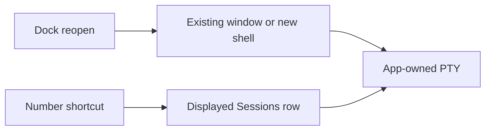

# Service-free 1.5.2

The owner delegated version choice, restoration of non-service changes and publication on 2026-10-24. Select 1.5.2 so an already distributed 1.5.1 remains below the new version. Do not publish 1.3.1 or restore the independent session service. The workspace version and changelog remain release-plz owned.

## Scope

Port the app-owned parts of #291 and #293 onto the v1.3.0 terminal baseline: Dock/Finder reopen, one window-close observer per app, Sessions row digit shortcuts and the moved font reset. Port #295's complete PID-file wait in tests. The other #295 changes concern service transport, persistence and reconnect and are excluded. Detached service rows and live reattachment after Quit are excluded. No new screen, dependency, background service or storage migration is introduced.

## Update behavior

1.3.0 uses its existing signed update handoff for app-owned processes. Versions 1.4.0 through 1.5.1 require a manual signed-app replacement: their updater rejects a feed without the service protocol marker. Do not falsely advertise that protocol or reintroduce the service. Finish service-owned runs before replacement; profile files remain intact and new app-owned terminals do not attach to old service runs. The three withdrawn releases stay private and cannot be republished by the release workflow.

## Validation and publication

Restore the existing scenario coverage and first show both digit scenarios failing on the rollback baseline. Run focused scenarios, fmt, clippy, workspace tests, product documentation and release-policy tests; CI checks macOS/Linux and the Windows build. Inspect actual native shell input, split navigation and reopen in an isolated profile. This is L1 changed behavior, without a UI redesign.

Public macOS publication still follows docs/releasing.md: three independent native reviews, 43 cases and 13 areas, separate before-build and before-deploy E2E, and exact signed-archive launch, update, IPC and shell-PID checks. The owner's release request does not label incomplete checks passed or carry over earlier candidate exceptions. If that gate cannot be completed, prepare the exact versioned candidate and report the remaining checks before any exception request. Signing, notarization and immutable artifact checks remain required. Linux packages are CI artifacts only unless separately accepted for Linux publication.

Personal settings and terminal-content backups were declined by the owner. Use only temporary test profiles.
